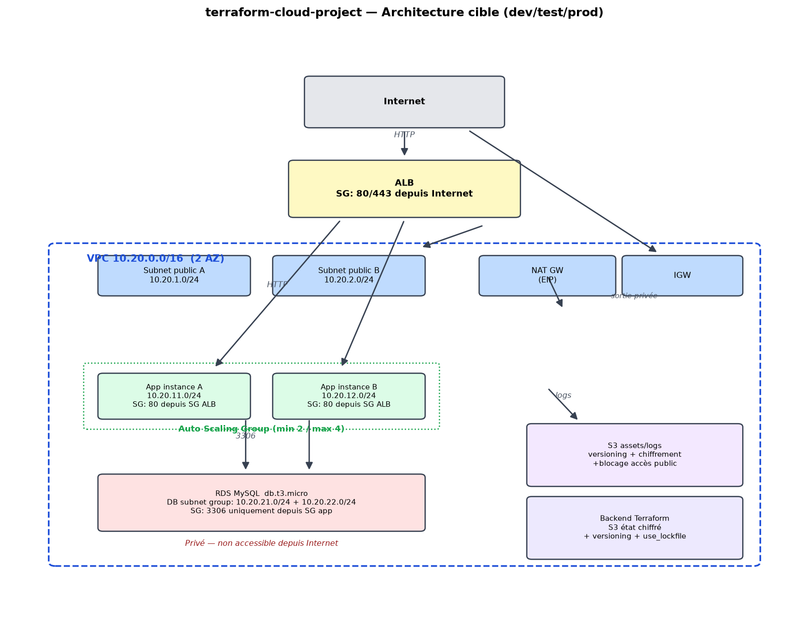

# terraform-cloud-project — Projet Terraform 5 (Cloud + CI/CD)

Infrastructure AWS **hautement disponible**, **modulaire** (6 modules Terraform),
**multi-environnements** (dev / test / prod), avec **backend distant** (S3) et
**pipeline CI/CD** (GitHub Actions).



## Architecture

- VPC `10.20.0.0/16` sur **2 zones de disponibilité**
- 2 subnets **publics** (ALB), 2 subnets **privés app** (instances), 2 subnets **privés db** (RDS)
- **ALB** public + **Auto Scaling Group** (min 2 / max 4, health check ELB)
- **RDS MySQL** chiffré, **non accessible depuis Internet** (Multi-AZ en prod)
- **S3** versioné, chiffré, blocage d'accès public
- Sortie privée contrôlée via **NAT Gateway**
- Etat Terraform **centralisé** dans S3 (chiffrement + versioning + `use_lockfile`)

## Prérequis

| Outil        | Version         |
|--------------|-----------------|
| Terraform    | >= 1.6.0 (testé 1.9.8) |
| AWS account  | IAM + OIDC (pipeline) |
| Git          | -               |

## Authentification (sans secret en clair)

```bash
# Poste de développement : variables d'environnement temporaires (jamais dans Git)
export AWS_ACCESS_KEY_ID=...
export AWS_SECRET_ACCESS_KEY=...
export AWS_SESSION_TOKEN=...   # session temporaire (AWS Academy)

# CI/CD : OIDC -> rôle IAM assumé (voir .github/workflows/terraform.yml)
```

## Déploiement d'un environnement

```bash
# 0) backend : créé une seule fois via bootstrap/
cd bootstrap && terraform init && terraform apply -var="state_bucket_name=<nom-unique>"
cd ..

# 1) environnement
cd environments/dev
cp terraform.tfvars.example terraform.tfvars   # sans secret !

# 2) mot de passe RDS par variable d'environnement (pas de fichier)
export TF_VAR_db_master_password="..."

terraform init
terraform plan -out=tfplan
terraform apply tfplan

# URL de démonstration
terraform output alb_url

# 3) destruction (obligatoire en fin de démonstration)
terraform destroy
```

Ou avec le script helper : `./scripts/deploy.sh dev init|plan|apply|destroy`

## Modules

| Module         | Contenu                                                            |
|----------------|--------------------------------------------------------------------|
| `modules/network`      | VPC, subnets (public/app/db), IGW, NAT, routage             |
| `modules/security`     | SG chaînés ALB→app→db, rôle IAM moindre privilège           |
| `modules/load-balancer`| ALB, target group + health checks, listener                 |
| `modules/compute`      | Launch Template (nginx), Auto Scaling Group                 |
| `modules/database`     | RDS chiffré, subnet group, non public                       |
| `modules/storage`      | S3 versioné, chiffré, cycle de vie                          |

Chaque module expose `variables.tf` (typées + validées), `outputs.tf`,
`versions.tf` et est documenté dans son `README.md`.

## Environnements

| Env  | Instances     | RDS          | Multi-AZ RDS | Backend key        |
|------|---------------|--------------|--------------|--------------------|
| dev  | t3.micro 2-2  | db.t3.micro  | non          | `dev/terraform.tfstate` |
| test | t3.micro 2-4  | db.t3.micro  | non          | `test/terraform.tfstate` |
| prod | t3.micro 2-4  | db.t3.micro  | **oui**      | `prod/terraform.tfstate` |

Les environnements partagent les **mêmes modules** ; seule la taille diffère
via les variables. Chaque env a son propre état (clé backend).

## Pipeline CI/CD (`.github/workflows/terraform.yml`)

À chaque **Pull Request** sur `main`, pour chaque environnement :

1. `terraform fmt -check -recursive`
2. `terraform init`
3. `terraform validate`
4. `terraform plan -out=tfplan` + publication du plan en **artifact**

L'**apply** est manuel (`workflow_dispatch`) avec **approval GitHub Environment**
pour `test` et `prod`. Aucun déploiement automatique depuis une branche non protégée.

## Variables principales

| Variable          | Exemple        | Description                     |
|-------------------|----------------|---------------------------------|
| `aws_region`      | `eu-west-1`    | Région de déploiement           |
| `environment`     | `dev`          | Environnement                   |
| `vpc_cidr`        | `10.20.0.0/16` | Bloc réseau principal           |
| `instance_type`   | `t3.micro`     | Type d'instance EC2             |
| `min_size`/`max_size` | `2`/`4`    | Capacité ASG                    |
| `db_instance_class`| `db.t3.micro` | Classe RDS                      |
| `project_name`    | `cloud5`       | Préfixe de nommage              |

## Tests

| Test          | Commande / procédure                    | Attendu                  |
|---------------|-----------------------------------------|--------------------------|
| Format        | `terraform fmt -check -recursive`       | Aucune différence        |
| Validation    | `terraform validate`                    | Success                  |
| Plan          | `terraform plan`                        | Sans erreur              |
| Accès Web     | Ouvrir `terraform output alb_url`       | Page disponible          |
| Répartition   | Rafraîchir plusieurs fois               | Hosts différents         |
| Panne         | Arrêter une instance                    | Service toujours UP      |
| Auto Scaling  | Modifier temporairement la capacité     | Adaptation du nombre     |
| Sécurité DB   | `nc -vz <rds_endpoint> 3306` depuis Internet | Refusé              |
| Destruction   | `terraform destroy`                     | Ressources supprimées    |

## Coûts et limites

- Voir `docs/costs.md` (~0,25 $ pour 2 h de démonstration, NAT GW à détruire).
- **Limites AWS Academy** : selon le lab, `iam:CreateRole`, `s3:CreateBucket`, RDS ou
  même `ec2:CreateVpc` peuvent être refusés. Le projet intègre des flags
  `enable_iam` / `enable_storage` / `enable_database` (défaut `true`) pour dégrader
  proprement, et l'AMI est fournie par variable (`modules/compute`). Sur un compte AWS
  standard, tout est déployé sans flag.

## Dépannage

| Symptôme                          | Solution                                     |
|-----------------------------------|----------------------------------------------|
| `BucketAlreadyExists` au bootstrap| Changer `state_bucket_name` (nom global)     |
| Verrou `use_lockfile` bloqué      | Supprimer le fichier `.tflock` dans S3       |
| `UnauthorizedOperation`           | Vérifier les permissions du rôle/session     |
| ALB 502 au démarrage              | Attendre le health check (~2 min)            |

## Licence

MIT — voir [LICENSE](LICENSE)
